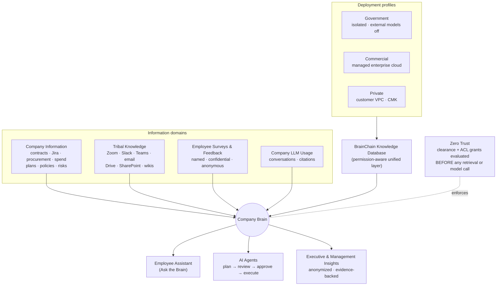
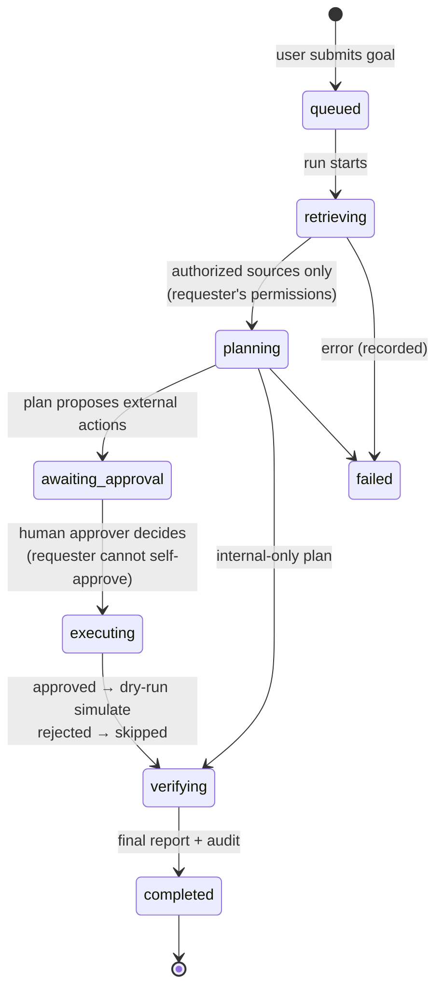
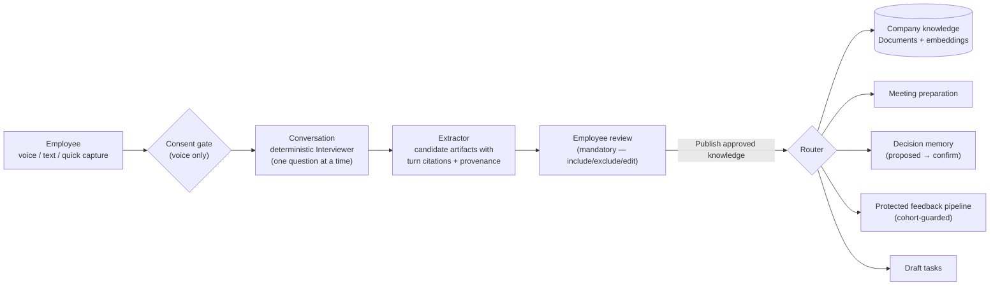

# Architecture

BrainChain is a permission-aware enterprise knowledge platform. Four information
domains — Company Information, Tribal Knowledge, Employee Surveys & Feedback, and
Company LLM Usage — feed a unified knowledge layer that powers the assistant, AI
agents, and management intelligence. Zero trust is enforced *before retrieval*, never
after.

## System overview

## Data flow (ingestion → answer)

```mermaid
flowchart LR
    SRC["Source system<br/>(Zoom/Slack/Jira/Drive/…)"] --> CONN["Connector<br/>status · health · counters"]
    CONN --> SYNC["SyncJob<br/>auditable log"]
    SYNC --> PARSE["Parsers<br/>files · messages · transcripts"]
    PARSE --> EXTRACT["Extraction<br/>decisions · tasks · owners<br/>deadlines · risks · questions"]
    PARSE --> NORM["Metadata normalization<br/>owner · dept · classification<br/>retention · dates · lineage"]
    NORM --> PERM["Permission sync<br/>AccessControlEntries"]
    NORM --> CHUNK["Chunker"]
    CHUNK --> EMB["Embeddings<br/>(local provider / pgvector)"]
    EMB --> STORE[("PostgreSQL / SQLite<br/>documents · chunks · graph")]
    PERM --> STORE

    Q["User question"] --> ACL{"accessible_document_ids(user)<br/>clearance ∧ grant"}
    STORE --> ACL
    ACL -->|authorized chunks only| RANK["Hybrid ranking<br/>cosine + keyword"]
    RANK --> POLICY{"Model policy<br/>classification ceiling ·<br/>external-call rules"}
    POLICY --> PROV["Provider<br/>local synthesis / OpenAI-compatible"]
    PROV --> ANS["Answer + segments + citations"]
    ANS --> AUDIT["AuditEvent"]
```

The security-critical property: the `ACL` step runs **before** ranking, so
unauthorized text is never scored, never in context, never in citations, and never in
the HTTP response. `apps/api/app/services/retrieval.py` is the single retrieval path
used by search, the assistant, and agents.

## Agent approval flow

External action types that always require approval: `send_email`, `post_message`,
`modify_jira`, `create_external_record`, `approve_spend`, `change_contract`,
`modify_permissions`, `export_sensitive`, `trigger_workflow`, `external_comm`
(`apps/api/app/services/agents_engine.py`).

## Knowledge architecture layers

1. **Connector layer** — `Connector` + mock upstreams (`services/connectors.py`)
2. **Ingestion queue** — in-process for the MVP; `workers/runner.py` is the queue seam
3. **Parsers** — file/message/transcript handling in the sync path
4. **Transcript processing** — speaker-turn parsing + rule-based extraction
5. **Metadata normalization** — `ingest_document()` (`services/ingestion.py`)
6. **Entity extraction** — `Entity` / `EntityRelationship` graph tables
7. **Permission synchronization** — `AccessControlEntry` written at ingest
8. **PII / sensitive-data classification** — `SecurityClassification` on every record
9. **Document storage** — `Document` / `DocumentVersion`
10. **Structured relational storage** — SQLAlchemy models (see below)
11. **Vector embeddings** — `DocumentChunk.embedding` (JSON locally, pgvector column in prod)
12. **Knowledge relationships** — relational graph, queried by `/entities/{id}/graph`
13. **Search & retrieval** — `services/retrieval.py` (hybrid, permission-first)
14. **LLM gateway** — `services/llm_gateway.py` (providers + policies + sanitization)
15. **Agent orchestration** — `services/agents_engine.py`
16. **Audit logging** — `security/audit.py`, queried by `/audit`
17. **Monitoring & evaluation** — request logs, connector health, `EvaluationRun`

## Brain Interview engine

The interview engine (docs/brain-interviews.md) adds a two-job AI pipeline in
front of the knowledge layer:

State machine, entities (`InterviewSession`, `InterviewTurn`,
`InterviewArtifact`, `AudioAsset`), API surface, publishing rules and the
privacy invariants are specified in docs/brain-interviews.md. Anonymous
sessions are receipt-token-only and never publish citable documents; voice
sessions require consent and can never be anonymous; deletion propagates
through every derived object including embeddings.

## Database schema

~35 entities in `apps/api/app/models.py`. The important clusters:

- **Tenancy & people**: `Organization` (deployment profile + settings), `Workspace`,
  `Department`, `User` (clearance level), `Group`, `Role`, `Permission`,
  `SessionToken`.
- **Governance**: `SecurityClassification` (level 0–3), `RetentionPolicy`.
- **Ingestion**: `DataSource` (owner/dept/classification/retention), `Connector`
  (health, counters), `SyncJob` (auditable log), `SourceItem`.
- **Documents**: `Document` (full provenance: source, owner, classification,
  retention, dates, confidence, meta incl. contract dates/values),
  `DocumentVersion`, `DocumentChunk` (text + embedding + fact-key metadata for
  conflict detection), `AccessControlEntry` (org/department/group/role/user
  principals, document- or source-scoped).
- **Knowledge graph**: `Entity` (16 kinds), `EntityRelationship` (typed edges).
- **Tribal knowledge**: `Meeting` (attendees + extraction), `Decision`
  (rationale, supersedes chain, sources).
- **Feedback**: `Survey`, `SurveyQuestion`, `FeedbackSubmission`
  (**user_id NULL for anonymous**, receipt token, coarsened timestamps),
  `FeedbackTheme`.
- **Assistant**: `Conversation`, `LLMMessage` (provenance segments, token/cost/latency),
  `Citation`.
- **Model gateway**: `ModelProvider`, `ModelPolicy` (classification ceiling, priority,
  dept/role scoping, logging policy, fallback).
- **Agents**: `Agent` (tool allowlist, approval-required actions), `AgentRun`
  (plan, assumptions, sources, cost), `AgentStep`, `Task`, `ApprovalRequest`.
- **Intelligence**: `Insight`, `ExecutiveSummary` (sections with evidence doc ids).
- **Audit & eval**: `AuditEvent` (nullable actor for anonymized events),
  `EvaluationRun`.

Migrations: Alembic (`apps/api/alembic/`), initial revision included. Dev mode also
`create_all`s on startup for frictionless first run.

### Vector storage: SQLite dev → pgvector production

Locally, embeddings are 256-dim feature-hashed vectors stored as JSON and ranked in
Python — deterministic and dependency-free at demo scale. On Postgres:

1. `DocumentChunk.embedding` becomes a `vector(N)` column (pgvector).
2. The permission pre-filter stays identical (`WHERE document_id IN (:allowed)`).
3. Ranking becomes `ORDER BY embedding <=> :query_vec LIMIT k` with an HNSW index.
4. `services/embeddings.py` swaps the provider for a real embedding model.

Nothing above the retrieval function changes.
